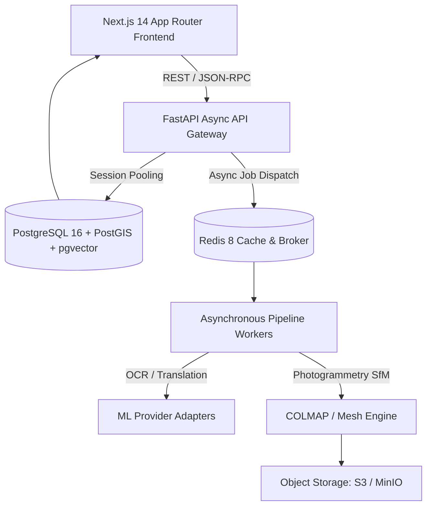
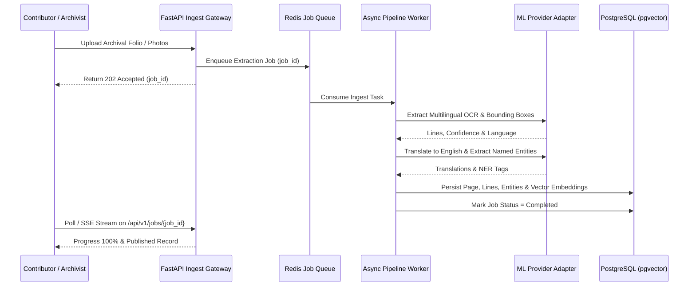

# Dharohar Atlas: System Architecture Specification

## 1. Architectural Overview

Dharohar Atlas is an event-driven, micro-modular web platform engineered to transform unstructured cultural and architectural heritage archives into a structured, searchable knowledge layer.

---

## 2. Layered Component Architecture

### 2.1 Presentation Tier (`apps/web`)
- **Next.js 14 App Router:** Server-rendered initial pages with client components for rich interactive experiences.
- **MapLibre GL JS:** Hardware-accelerated WebGL vector map rendering clustered archaeological monuments with custom canvas layers.
- **React Three Fiber & Drei:** WebGL 3D rendering pipeline loading GLB photogrammetric models with directional lighting, spatial hotspot raycasting, and metric measurement calipers.
- **Interactive Bounding Box Canvas:** High-precision SVG/DOM overlay aligning machine OCR bounding boxes with archival folios.

### 2.2 Backend & Service Tier (`apps/api`)
- **Clean Layered Separation:**
  - `api/v1/`: HTTP routers handling validation and status codes (zero business logic).
  - `services/`: Encapsulated domain business logic (`SiteService`, `SearchService`, `DocumentService`, `RouteService`).
  - `providers/`: ML and OCR adapter abstraction layer.
  - `models/`: SQLAlchemy 2.0 ORM entities with pgvector columns.

### 2.3 Storage & Retrieval Tier
- **PostgreSQL 16:** Single unified datastore hosting relational metadata, geospatial geography, trigram lexical indexes, and HNSW vector graphs.
- **Redis 8:** Query caching layer and job broker for long-running photogrammetry tasks.

---

## 3. Ingestion Sequence

