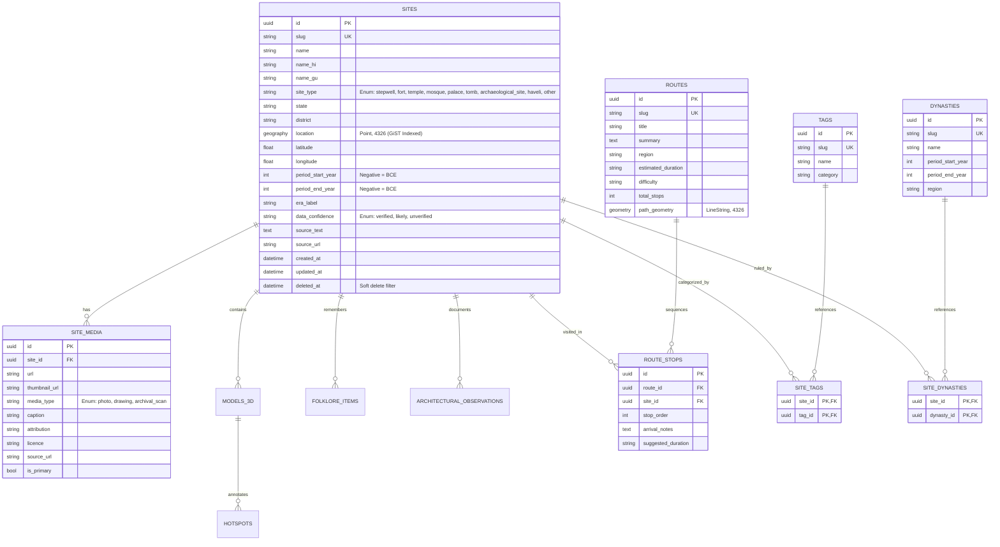

# Dharohar Atlas: Database Schema & Indexing Strategy (M1 Release)

## 1. Entity Relationship (ER) Diagram



---

## 2. High-Performance Geospatial & Full-Text Indexing Strategy

1. **PostGIS GiST Spatial Index on Geography:**
   ```sql
   CREATE INDEX idx_sites_location 
   ON sites 
   USING gist (location);
   ```
   Enables lightning-fast bounding box viewport queries (`ST_Intersects`) and distance-based clustering calculations (`ST_SnapToGrid`, `ST_ClusterDBSCAN`) across millions of coordinate pairs.

2. **Trigram GIN Indexes for Fuzzy Multilingual Matching:**
   ```sql
   CREATE INDEX idx_sites_name_trgm ON sites USING gin (name gin_trgm_ops);
   CREATE INDEX idx_sites_name_hi_trgm ON sites USING gin (name_hi gin_trgm_ops);
   CREATE INDEX idx_sites_name_gu_trgm ON sites USING gin (name_gu gin_trgm_ops);
   ```
   Enables sub-millisecond substring matching across Romanized, Devanagari, and Gujarati characters.

3. **Compound B-Tree Filter Indexes:**
   ```sql
   CREATE INDEX idx_sites_state_type ON sites (state, site_type);
   CREATE INDEX idx_sites_period_years ON sites (period_start_year, period_end_year);
   CREATE INDEX idx_sites_confidence ON sites (data_confidence);
   CREATE INDEX idx_sites_deleted_at ON sites (deleted_at);
   ```

4. **Integrity & Check Constraints:**
   ```sql
   ALTER TABLE sites ADD CONSTRAINT check_period_years 
   CHECK (period_start_year IS NULL OR period_end_year IS NULL OR period_start_year <= period_end_year);

   ALTER TABLE sites ADD CONSTRAINT check_coordinates 
   CHECK (latitude BETWEEN -90.0 AND 90.0 AND longitude BETWEEN -180.0 AND 180.0);
   ```
