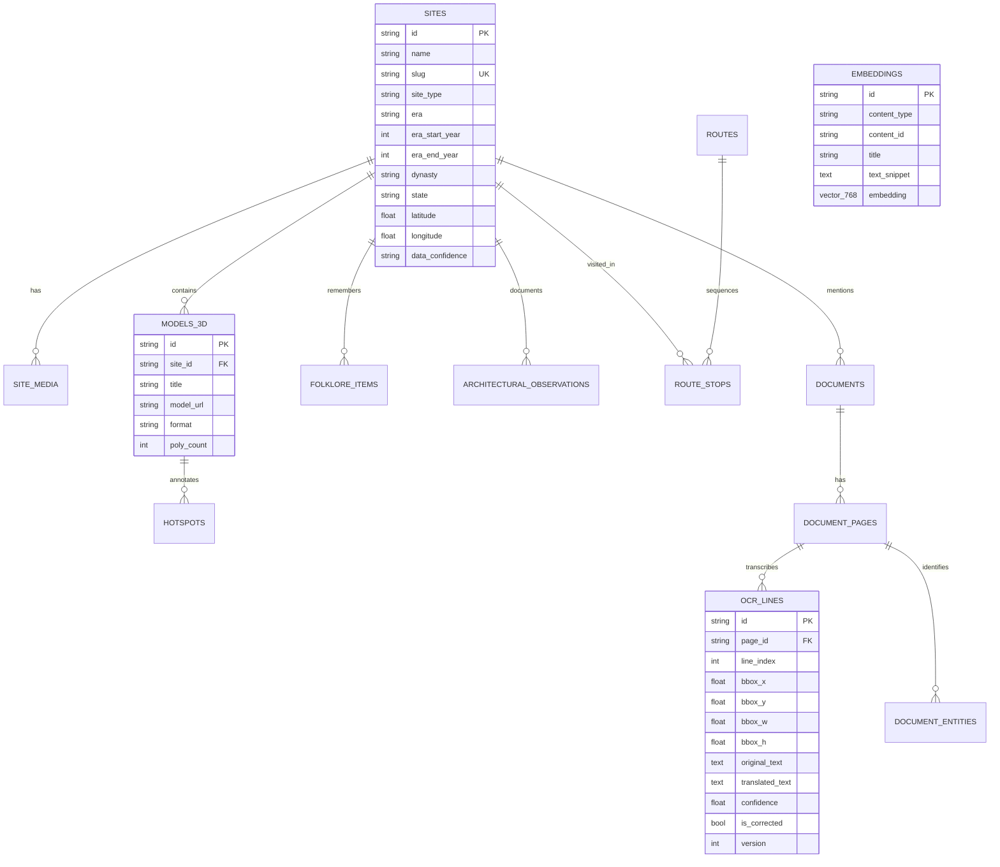

# Dharohar Atlas: Database Schema & Indexing Strategy

## 1. Entity Relationship (ER) Diagram



---

## 2. High-Performance Indexing Strategy

1. **pgvector HNSW (Hierarchical Navigable Small World) Index:**
   ```sql
   CREATE INDEX embeddings_hnsw_idx 
   ON embeddings 
   USING hnsw (embedding vector_cosine_ops)
   WITH (m = 16, ef_construction = 64);
   ```
   Provides sub-5ms nearest-neighbor semantic vector retrieval across thousands of entries.

2. **Trigram GIN Indexes for Full-Text Lexical Matching:**
   ```sql
   CREATE INDEX sites_name_trgm_idx ON sites USING gin (name gin_trgm_ops);
   CREATE INDEX sites_desc_trgm_idx ON sites USING gin (description gin_trgm_ops);
   CREATE INDEX ocr_lines_trgm_idx ON ocr_lines USING gin (original_text gin_trgm_ops);
   ```
   Enables lightning-fast fuzzy matching on Sanskrit, Hindi, and English substrings.

3. **Spatial Bounding Box Coordinates:**
   Indexed on `latitude` and `longitude` for fast viewport queries on the map.
