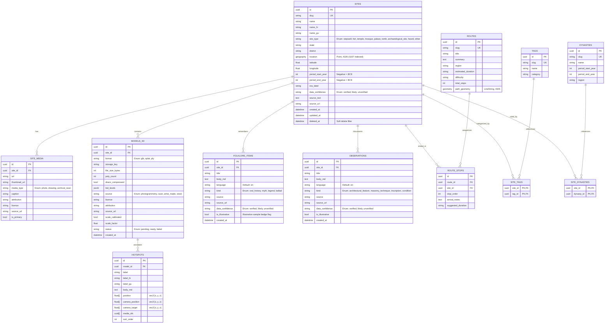

# Dharohar Atlas: Database Schema & Indexing Strategy (M1 + M2 Releases)

## 1. Entity Relationship (ER) Diagram



---

## 2. High-Performance Geospatial, Foreign Key & Filter Indexing

1. **PostGIS GiST Spatial Index on Geography:**
   ```sql
   CREATE INDEX idx_sites_location ON sites USING gist (location);
   ```
   Enables lightning-fast bounding box viewport queries (`ST_Intersects`) and geodesic distance calculations (`ST_Distance`, `ST_DWithin`) for nearby monument trails.

2. **3D Models & Hotspots Relational Indexing:**
   ```sql
   CREATE INDEX ix_models_3d_site_id ON models_3d (site_id);
   CREATE INDEX ix_models_3d_status ON models_3d (status);
   CREATE INDEX ix_hotspots_model_id ON hotspots (model_id);
   CREATE INDEX ix_hotspots_sort_order ON hotspots (sort_order);
   ```

3. **Folklore & Field Observations Indexing:**
   ```sql
   CREATE INDEX ix_folklore_items_site_id ON folklore_items (site_id);
   CREATE INDEX ix_folklore_items_is_illustrative ON folklore_items (is_illustrative);
   CREATE INDEX ix_observations_site_id ON observations (site_id);
   CREATE INDEX ix_observations_is_illustrative ON observations (is_illustrative);
   ```

4. **Trigram GIN Indexes for Fuzzy Multilingual Matching:**
   ```sql
   CREATE INDEX idx_sites_name_trgm ON sites USING gin (name gin_trgm_ops);
   CREATE INDEX idx_sites_name_hi_trgm ON sites USING gin (name_hi gin_trgm_ops);
   CREATE INDEX idx_sites_name_gu_trgm ON sites USING gin (name_gu gin_trgm_ops);
   ```

5. **Compound B-Tree Filter Indexes:**
   ```sql
   CREATE INDEX idx_sites_state_type ON sites (state, site_type);
   CREATE INDEX idx_sites_period_years ON sites (period_start_year, period_end_year);
   CREATE INDEX idx_sites_confidence ON sites (data_confidence);
   CREATE INDEX idx_sites_deleted_at ON sites (deleted_at);
   ```
